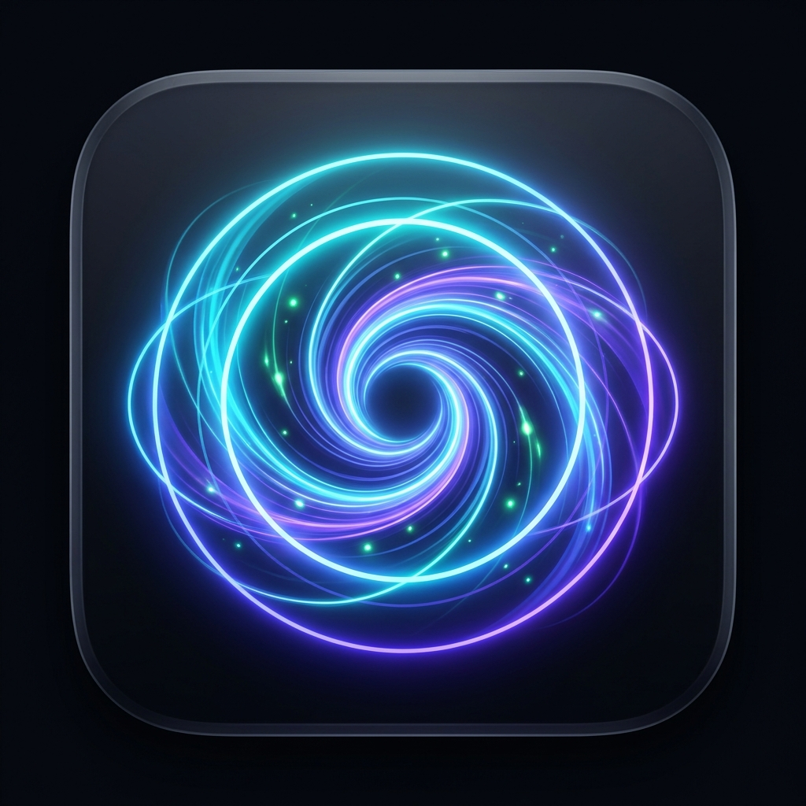
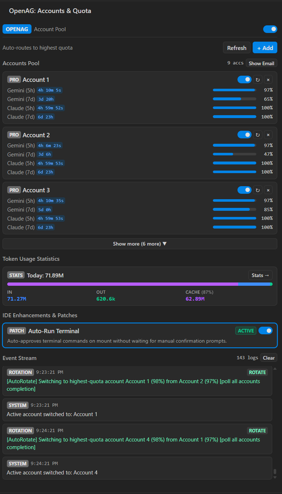
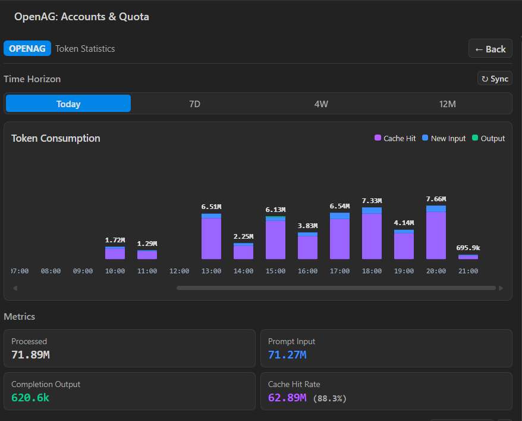

<div align="center">



# AgyPool - Antigravity Account Pool & Quota Manager

### Smart Multi-Account Pool & Quota Manager for Google Antigravity

[](https://open-vsx.org/extension/hoducvinhh/agypool)
[](https://open-vsx.org/extension/hoducvinhh/agypool)
[](LICENSE)

<p>
  A smart multi-account pool manager for Google Antigravity. Automatically rotates to the account with the highest available quota before every prompt, syncs credentials with the IDE in real-time, and provides fine-grained quota monitoring across all AI models.
</p>

**Available directly on the [Open VSX Registry](https://open-vsx.org/extension/hoducvinhh/agypool) & IDE Extension Marketplace!**

</div>

---

## ⚡ Overview

When working on large-scale development tasks in **Antigravity IDE**, individual Google account quotas can deplete quickly. **AgyPool** solves this by maintaining a pool of authorized Google accounts and intelligently routing your requests to the healthiest account.

With deep hooks into Antigravity's **Unified State Sync (USS)**, **Language Server**, and **Windows Credential Manager**, account switching happens seamlessly in the background without interrupting your ongoing conversations or development workflow.

---

## 📸 Screenshots

<div align="center">
  
  <p><em>Overview Dashboard: Account Deck, Real-time Quota Gauges & Status Indicators</em></p>
  <br/>
  
  <p><em>Analytics & Telemetry: Model Token Breakdown, Latency, and Cache Hit Rates</em></p>
</div>

---

## ✨ Key Features

- **🚀 Automated Smart Rotation Strategies**:
  - **Highest Quota First (`auto_highest`)**: Always switches to the account with the greatest remaining quota.
  - **Cache Optimized (`cache_optimized`)**: Remains on the active account until quota falls below 15% to maximize prompt cache hits.
  - **Round Robin (`round_robin`)**: Sequentially rotates across healthy accounts to evenly balance the 5-hour replenishment cycles.
- **⚡ Zero-Friction PreInvocation Hook**:
  - Automatically intercepts prompts *before* execution and updates Windows Credential Manager (`gemini:antigravity`) and Antigravity IDE state in real-time.
- **📊 Granular Quota & Reset Tracking**:
  - Live 5-hour sliding window and weekly quota tracking.
  - Dedicated monitoring for **Gemini 2.5 / 3.7 Pro & Flash**, **Claude 3.5 / 3.7 Sonnet**, **Haiku**, and **GPT-4o**.
  - Dynamic countdown timers showing exact refill timestamps.
- **🎯 Model Affinity & Reserve Account Pool**:
  - Bind specific accounts to preferred model families.
  - Designate standby "Reserve" accounts that only activate when primary accounts drop below critical thresholds.
- **📈 Advanced Analytics & Telemetry**:
  - Visualize daily, weekly, and monthly token consumption (Input, Output, Thinking tokens, and Cache Hit Rates).
- **🔒 Security & Privacy by Design**:
  - OAuth tokens stored securely in VS Code `SecretStorage` and Windows Credential Manager.
  - One-click privacy mask for email addresses on the UI and status bar.
  - Encrypted pool export/import with **AES-256-GCM** and PBKDF2 password protection.

---

## 📦 Installation

### Option 1: Install from the Extension Marketplace (Recommended)

AgyPool is published on the **Open VSX Registry** and is accessible in Antigravity IDE, VSCodium, and VS Code.

1. Open the **Extensions** view (`Ctrl+Shift+X` or `Cmd+Shift+X`).
2. Search for **`AgyPool`** or **`hoducvinhh.agypool`**.
3. Click **Install**.

Or install directly via CLI:
```bash
# Antigravity CLI
agy --install-extension hoducvinhh.agypool

# VS Code / VSCodium CLI
code --install-extension hoducvinhh.agypool
```

Marketplace Link: [https://open-vsx.org/extension/hoducvinhh/agypool](https://open-vsx.org/extension/hoducvinhh/agypool)

---

### Option 2: Install from `.vsix` Package

1. Download the latest `.vsix` release from the [GitHub Releases](https://github.com/hoducvinhh/agypools/releases) page.
2. In your IDE, open the Command Palette (`Ctrl+Shift+P` / `Cmd+Shift+P`) and select:
   ```
   Extensions: Install from VSIX...
   ```
3. Select the downloaded `.vsix` file.

---

## 🚀 Quick Start Guide

1. **Open AgyPool**:
   Click on the **AgyPool** icon in the Activity Bar on the left.
2. **Auto-Detection**:
   Your currently signed-in Antigravity account is automatically detected and populated.
3. **Add Accounts**:
   Click **+ Add Account** to authenticate additional Google accounts via the secure local browser OAuth flow.
4. **Choose Rotation Strategy**:
   Navigate to the **Settings** tab and pick your desired strategy (`Auto Highest Quota`, `Cache Optimized`, or `Round Robin`).
5. **Start Coding**:
   AgyPool handles the rest. As your prompts consume quota, accounts rotate automatically with zero interruption.

---

## ⚙️ Configuration Settings

Customize behavior under `Settings` > `Extensions` > `AgyPool`:

| Setting | Type | Default | Description |
| :--- | :--- | :--- | :--- |
| `agypool.enabled` | `boolean` | `true` | Enable or disable multi-account rotation. |
| `agypool.rotationStrategy` | `string` | `"auto_highest"` | Strategy: `auto_highest`, `cache_optimized`, or `round_robin`. |
| `agypool.hideEmail` | `boolean` | `false` | Mask email addresses in status bar and notifications. |
| `agypool.pollIntervalSeconds` | `number` | `60` | Background polling interval for quota updates. |
| `agypool.endpointOverride` | `string` | `""` | Custom Cloud Code PA endpoint override. |

---

## 📄 License

This project is licensed under the [MIT License](LICENSE) © **hoducvinhh**.
